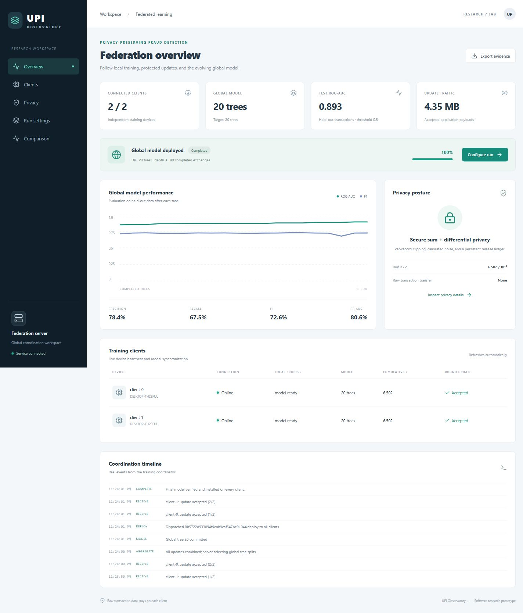

# Federated UPI Fraud Detection

A software research prototype for privacy-preserving UPI fraud detection. It combines a centralized LightGBM baseline, federated histogram-based gradient-boosted trees, secure aggregation, differential privacy, and a React dashboard for the server and individual training clients.

**Current status:** the integrated software has been tested with one server and two independent client processes on a Windows laptop. Physical three-device LAN acceptance and Raspberry Pi/Jetson/Smart POS hardware integration remain pending. The model is **GBDT, not GNN or neural FedAvg**.



## What the system does

- Trains on each client's local transaction shard without uploading raw transaction rows to the coordinator.
- Builds global trees from client gradient, Hessian, and count histograms.
- Supports plain comparison, pairwise secure aggregation, and secure aggregation with record-level differential privacy.
- Tracks client connections, synchronization, tree progress, evaluation metrics, communication, and privacy spending.
- Saves protected releases in a local ledger so retries reuse the same response and privacy cost.
- Delivers the final model to every client and verifies checksum acknowledgements.
- Scores local transactions through a client dashboard and reports inference latency.

## Architecture

```text
Device B: client 0                         Device C: client 1
Private transaction shard                 Private transaction shard
Local histogram computation               Local histogram computation
Optional clipping + Gaussian noise        Optional clipping + Gaussian noise
Pairwise masking in protected modes       Pairwise masking in protected modes
                \                         /
                 Protected model statistics
                            |
                 Device A: coordinator
                 Aggregate all client updates
                 Build and evaluate global trees
                            |
                 Deliver model to both clients
                            |
                 Local fraud-risk inference
```

The integrated dashboard runtime uses `service.server` and `service.client`. The original Flower runtime under `fl/` is retained and tested separately; its commands do **not** automatically enable the integrated dashboard or its privacy mechanisms.

## Quick start on Windows

Use **Python 3.12**, **Node.js 20 or newer**, npm, and Git. Run the following in PowerShell. Keep the repository's folder name if you already have a checkout; cloning is only needed for a new installation.

### 1. Get the project

```powershell
git clone https://github.com/Anjali-Mishra05/BE_Major_Project.git
cd BE_Major_Project
```

### 2. Install and build

```powershell
py -3.12 -m venv .venv
.\.venv\Scripts\python.exe -m pip install -r requirements-tested.txt
npm.cmd ci --prefix dashboard
npm.cmd run build --prefix dashboard
```

`requirements-tested.txt` records the tested Windows environment. `requirements-dashboard.txt` contains portable dependency ranges for other setups; those environments need their own verification. `requirements.txt` records the original Phase I baseline dependencies and is not the complete dashboard environment.

### 3. Prepare the two client shards

```powershell
.\.venv\Scripts\python.exe fl/make_partitions.py --clients 2
```

This writes separate bank-based client shards, held-out validation/test CSVs, the shared schema, and a partition summary. Generate these once for an experiment and distribute the same schema to every device. Do not regenerate partitions during a run.

### 4. Train and open the dashboards

```powershell
.\.venv\Scripts\python.exe -m service.lab --trees 20 --depth 3 --serve
```

The launcher starts three independent processes, runs plain, secure, and DP experiments in sequence, evaluates the saved centralized baseline, and keeps the dashboards available afterward. This is a **single-laptop demonstration**, not three physical devices.

| View | Local address |
|---|---|
| Server coordination and comparisons | <http://127.0.0.1:8080> |
| Client 0 training and inference | <http://127.0.0.1:8081> |
| Client 1 training and inference | <http://127.0.0.1:8082> |

Keep the terminal open. Press **Ctrl+C** to stop the launcher and its child services. Do not start a second launcher on the same ports.

The launcher prints the path to its local `server.json`. Read the `admin_token` from that file and enter it in the server dashboard's **Run settings** to start or cancel additional runs. Do not share or commit that file.

### Reopen without retraining

After the first-time setup and partitioning:

```powershell
.\Start-Dashboard.ps1
```

The launcher reuses the saved lab with the greatest number of model trees, preferring the newest when tied. If no saved model exists, it opens an idle lab. Existing client privacy ledgers are retained when a saved lab is reused.

For a quick isolated integration check that preserves the published 20-tree comparison report:

```powershell
.\.venv\Scripts\python.exe -m service.lab --trees 3 --depth 2 --port 8380 --report runtime/quick-check.json
```

Without `--serve`, the services stop when evaluation finishes. The standard launcher writes `reports/software_comparison.json`; rerunning it replaces that report. Use `--report` for separate experiments.

## Run across three physical devices

Use **one coordinator and two training clients**. Each device runs the Python service and serves its own built React dashboard; Node is only needed for the build.

| Device | Runtime | Data and credentials |
|---|---|---|
| A: server | `python -m service.server` | Server credentials, shared schema, designated held-out test data |
| B: client 0 | `python -m service.client --config runtime/client-0.json --port 8081` | Only client 0's shard and credentials, plus the shared schema |
| C: client 1 | `python -m service.client --config runtime/client-1.json --port 8081` | Only client 1's shard and credentials, plus the shared schema |

Activate the device's Python environment before using the generic `python` commands above. Both clients can use port 8081 because they are on different machines.

Follow the [three-device runbook](docs/dashboard_runbook.md) for provisioning, file distribution, server address, TLS certificates, network access, and the demonstration sequence. The client UI binds to loopback so local transaction samples are not exposed to other devices. The local demo uses HTTP; TLS requires explicit configuration for the LAN.

The repository already contains the research dataset for reproducibility. On a real deployment, provision each device with only the data it should hold; copying the complete repository dataset onto the coordinator does not demonstrate data isolation.

## Privacy modes

| Mode | Protection | Intended use |
|---|---|---|
| `plain` | Individual client histograms are visible to the server; no DP | Comparison/control experiment |
| `secure` | Pairwise masks conceal individual updates under the documented threat model | Secure aggregation experiment; no DP guarantee |
| `dp` | Joint per-record clipping, Gaussian noise, and pairwise masking | Privacy/utility experiment with cumulative accounting |

All provisioned clients must contribute to a secure aggregate. A missing client causes a bounded failed run; there is no unprotected fallback or partial-cohort aggregation.

Client epsilon is **cumulative across releases stored in that client's ledger**. Server epsilon describes the **current run**. Retries return the same persisted protected response. Starting a fresh lab identity or deleting a ledger does not erase privacy loss from previous releases of the same underlying data.

The research threat model assumes an honest-but-curious server, honest non-colluding clients, and trusted key provisioning. Two-client collusion and floating-point Gaussian sampling limitations are documented in [Privacy design and limits](docs/privacy.md). This is not an audited production privacy system, and secure aggregation does not replace TLS.

## Dataset and preprocessing

- **332,693 transactions**, approximately **25% fraud**, with synthetic fraud labels.
- **71 model features** after excluding identifiers and label-derived `behaviour_*` columns.
- **232,885 training rows**, **49,904 validation rows**, and **49,904 test rows**.
- Two non-IID client shards grouped by sender bank; the partitioner also supports IID experiments.
- Amount bins use a fixed public INR domain of **0 to 1,000,000**, with values outside the domain mapped to boundary bins.
- Federated and baseline comparison use the same training/test indices. Validation rows are not included in federated fitting.

See [partition metadata](data/fl/partition_summary.json) and the [preprocessing notebook](notebooks/01_preprocessing.ipynb). These results do not establish performance on real bank fraud. A majority-class predictor achieves roughly 75% accuracy here while detecting no fraud, so accuracy must be read alongside fraud precision/recall and PR-AUC.

## Recorded performance

The following experiment used **20 federated trees, depth 3**, evaluated on the same **49,904 test records** at threshold **0.5**. The saved centralized model was re-evaluated, not retrained.

| Model | Accuracy | Precision | Recall | F1 | ROC-AUC | PR-AUC |
|---|---:|---:|---:|---:|---:|---:|
| Centralized LightGBM | 0.8625 | 0.6978 | 0.7937 | 0.7426 | 0.9115 | 0.8577 |
| Plain federated | 0.8903 | 0.8646 | 0.6653 | 0.7519 | 0.9060 | 0.8393 |
| Secure federated | 0.8903 | 0.8646 | 0.6653 | 0.7519 | 0.9060 | 0.8393 |
| Secure + DP | 0.8724 | 0.7843 | 0.6753 | 0.7257 | 0.8930 | 0.8059 |

The DP run used clipping norm **10**, noise multiplier **8**, and **80 releases per client**, yielding run **epsilon 6.502 at delta 1e-6**. Noise is randomized; repeated DP runs need not produce identical results.

Recorded median local inference times were **7.18 ms (plain)**, **8.66 ms (secure)**, and **7.62 ms (DP)** on the test laptop. Models were approximately **39–40 KB**. These are single-run measurements, not hardware guarantees. Inference timing includes binning and model scoring but excludes HTTP; communication figures count application payloads, not all network framing.

The baseline uses different tree growth and class weighting. Plain versus secure is the direct masking control; baseline versus federated is not a controlled comparison of federation alone.

Full evidence: [comparison JSON](reports/software_comparison.json), [software validation](reports/software_validation.md), and [synthetic scaling results](reports/scalability.json).

## Testing and recovery

Latest recorded validation of the synchronization fixes: **23 automated tests passed**, React production build passed, and Python dependency checks passed. Real-process tests verified:

- Plain, secure, and DP dashboard-runtime training, final-model delivery, and local inference.
- Flower deployment with two clients contributing to all six exchanges for three trees.
- Recovery after stopping and restarting a client during training.
- Bounded failure when a client drops out, without partial aggregation.
- Strong tree fingerprints, base-score synchronization, empty-model reset, and invalid forest-length rejection.

Run the checks from the repository root:

```powershell
.\.venv\Scripts\python.exe -m unittest discover -s tests -v
.\.venv\Scripts\python.exe -m pip check
.\.venv\Scripts\python.exe -m service.network_check
.\.venv\Scripts\python.exe -m service.scalability
.\.venv\Scripts\python.exe fl/smoke_test.py
npm.cmd run build --prefix dashboard
```

The Flower smoke test requires **Flower 1.39.0**, included in the tested dependency file. The network acceptance check uses ports **8180–8182**. Tests create their own local processes and stop them afterward. Scaling evidence covers 2, 3, and 5 synthetic clients in one process, not physical-network scalability.

A restarted client can recover from the supplied model and its durable ledger. A restarted coordinator marks an unfinished run interrupted; a new run must be started. Passing tests do not promise zero future failures.

See the [merged-main validation record](reports/merged_main_validation.md) and [network acceptance report](reports/network_acceptance.json). The validation record describes the original test session; the synchronization fixes are now merged into `main`.

## Objective status

| Objective | Software status | Remaining acceptance |
|---|---|---|
| 1. Dataset preparation | Implemented on the supplied research dataset | Independent real-world provenance/collection not established |
| 2. Centralized baseline | Implemented and evaluated | Real-bank validation outside current evidence |
| 3. Lightweight edge model | Compact model and local inference implemented | Raspberry Pi/Jetson deployment and latency |
| 4. Federated environment | Independent client processes tested | Physical three-device LAN run |
| 5. Aggregation and comparison | Implemented and evaluated | Wider experiments as needed |
| 6. Secure aggregation and DP | Research mechanisms and accounting tested | Security assumptions and numerical limitations remain |
| 7. Smart POS integration | Integrated software prototype | Physical POS, peripherals, and hardware integration |
| 8. System evaluation | Local metrics, latency, communication, privacy and synthetic scaling | Device-specific and physical-network evaluation |

The eight objectives are **not all fully accepted**. If the academic specification mandates a GNN specifically, that modeling requirement is also outstanding. See [objective details](docs/objectives_status.md).

## Repository layout

```text
dashboard/                  React dashboard source and npm lock file
service/                    Coordinator, client worker, privacy, provisioning and lab tools
fl/                         Original Flower runtime, GBDT, partitioning and smoke test
src/                        Centralized baseline training and evaluation
tests/                      Protocol, privacy, inference and model-loading tests
data/                       Research data and generated local partitions
models/                     Saved baseline/reference models
notebooks/                  Preprocessing workflow
reports/                    Measured results and validation evidence
docs/                       Deployment, objectives and privacy documentation
runtime/                    Local credentials, ledgers, logs and run models (ignored)
Start-Dashboard.ps1          Reopen a prepared local dashboard without retraining
```

## Baseline tools

In the prepared environment, the original baseline commands remain available:

```powershell
.\.venv\Scripts\python.exe src/evaluation.py
.\.venv\Scripts\python.exe src/evaluation.py --split chronological
.\.venv\Scripts\python.exe src/evaluation.py --html --save
```

To deliberately retrain the baseline and overwrite its model/report artifacts:

```powershell
.\.venv\Scripts\python.exe src/train_baseline.py
```

Each split has its own model. Do not evaluate the stratified model on the chronological test partition, or vice versa, because their training rows overlap differently. The historical Phase I results and methodology remain in [baseline_results.md](reports/baseline_results.md).

## Files that stay local

`.gitignore` excludes environments, dependencies, dashboard build output, runtime credentials and ledgers, private key files, local environment files, generated client/test CSVs, caches, temporary files, and test output. Source, dependency lock files, documentation, and selected validation reports are intentionally tracked.

The original raw and processed CSVs are already tracked and remain in Git history. Ignoring new processed files does not remove existing large blobs. Review staged files before committing; do not force-add ignored credentials or generated data.

## Troubleshooting

| Symptom | Action |
|---|---|
| Missing shard or schema | Run the partitioner once, then use the same schema on every device. |
| Port already in use | Stop the earlier launcher, or select a different base port with `--port`. |
| Client offline | Check the coordinator address, credentials, certificate trust, network access and client log. |
| Schema mismatch | Copy the experiment's exact schema to both clients; do not mix regenerated schemas. |
| Privacy budget exhausted | Inspect the existing cumulative ledger and experiment plan. Deleting the ledger does not restore privacy. |
| Coordinator interrupted | Inspect logs and start a new run; automatic coordinator checkpoint resume is not implemented. |
| Saved LightGBM model fails on Windows | Use the repository's loader, which normalizes line endings; `.gitattributes` preserves LF model files. |

For deployment details, start with the [dashboard runbook](docs/dashboard_runbook.md). For the separate original Flower setup, see [fl_runbook.md](docs/fl_runbook.md).
